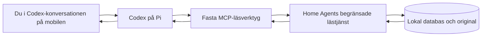

# Codex som AI-arbetsyta — första läskopplingen

**Beslutat av ägaren:** 2026-10-26. **Leverans:** Home Agent 0.8.8 + Codex Remote Test 0.1.5.
Automatiska tester verifierar mekaniken med syntetiska data. Verkligt NIBE-/bildprov på Pi återstår.

## Ansvar och inriktning

Home Agent äger databasen, permanenta ID:n, relationer och original. Codex använder
ägarens ChatGPT-abonnemang för interaktiv analys av text, PDF och bilder. Ingen
modell körs på Pi:n och ingen separat betald modell-API-nyckel behövs.
Material som analyseras kan skickas till OpenAI genom den anslutna Codex-konversationen.
Vanliga ChatGPT-konversationer får inte automatiskt samma åtkomst.

Drive-publicering för vanlig ChatGPT pausas som huvudspår och i exportens
bakgrundsworker. Befintliga Drive-filer, tokens och inställningar raderas inte.
Drive behåller rollen backup/arkiv; full backup och återställning återstår.
Ingen Drive-anslutning krävs för Codex-läsningen.

## Anslut från telefonen

1. Merga leveransens PR. Uppdatera **både Home Agent till 0.8.8 och Codex Remote Test till 0.1.5**. Befintlig Codex-inloggning och konversation behålls.
2. Öppna Home Agent → **Mer → Anslut Codex**.
3. Välj **Aktivera och skapa läsnyckel**. Kopiera hela nyckeln. Den visas endast i detta svar och är en hemlig åtkomstnyckel, inte en OpenAI-parkod.
4. Öppna Codex Remote Tests webbgränssnitt. Klistra in nyckeln under **Home Agent** och tryck **Anslut Home Agent**. Klistra aldrig in den i chatten.
5. Vänta på **Ansluten till OpenAI** och fortsätt i Codex-konversationen. Be uttryckligen om Home Agent-verktygen vid första provet.
6. Om en gammal konversation inte visar de nya verktygen, prova en ny Codex-konversation på samma Pi och projektmapp `/data/workspace`.

### Om knappen inte gav någon nyckel i 0.8.7

Meddelandet **Åtgärden måste startas från Home Agent** kunde visas trots att
knappen användes på rätt sida. Sidans tidigare `no-referrer`-policy kan ge
`Origin: null` på HTTP-formulär i webbläsaren. Uppdatera **Home Agent till 0.8.8**,
öppna sidan på nytt via Mer och prova igen. Codex-tillägget ligger kvar på 0.1.5.
Rättningen kräver fortfarande den oförutsägbara CSRF-koden från den aktuella sidan,
nekar uttryckliga främmande origin/cross-site-anrop och lämnar inte ut nyckeln via GET.

Home Agent identifierar sitt interna HA-värdnamn, exempelvis `<repo-id>-home-agent`.
Nyckeln innehåller värdnamn, fast lässcope och en slumpmässig 256-bitars token.
Klienten tillåter endast HA-tilläggsnamn av avsett format, fast port 8100 och fasta
API-sökvägar; inga godtyckliga URL:er, proxyinställningar eller redirects följs.
Installationshashen följer automatiskt med, utan att ägaren behöver skriva Pi-adressen.
Om ett annat runtime-värdnamn används nekas konfigurering i stället för att gissa.

## Vad kan läsas?

Home Agent 0.8.10 + Codex Remote Test 0.1.7 lägger till
`home_agent_archive_audit`: [skrivskyddad arkivrapport](ARCHIVE_AUDIT.md), separat
avstängd tills ägaren aktiverar delning. Detta ger inte utökat filscope till
`home_agent_source`. Befintlig nyckel och NIBE-läsning behålls.

- `home_agent_index`: namn, typ och permanenta ID:n för navigation. Valfri sökning; högst 200 träffar per svar, med besked om fler träffar finns.
- `home_agent_nibe`: aktuella lagrade uppgifter om det befintliga NIBE S1255-objektet, explicit kopplad service/underhåll, relationer och Source-ID:n.
- `home_agent_source`: en uttryckligen NIBE-kopplad PDF, bild eller textfil med verifierad lokal custody och SHA-256, högst 25 MB.

Underlaget bygger på samma begränsade läsmodell som tidigare Drive-export. Det
läser SQLite i en read-only-transaktion och innehåller revision, tidpunkt och
permanenta ID:n. Privata inställningar, lagringssökvägar och andra objekts
detaljuppgifter lämnas inte ut. Indexet innebär inte att alla objekts detaljer
är tillgängliga. Saknas det avsedda NIBE-objektet väljs inget annat som ersättning.

Original hämtas vid behov till Codex-tilläggets privata
`/data/workspace/home-agent-sources`, med Source-ID och hash i filnamnet. Båda
sidor kontrollerar checksumma. Originalet ändras inte. Codex öppnar bilden med
bildverktyget och använder `pdftotext`/`pdftoppm` för PDF. Enbart metadata eller en
sökväg får inte rapporteras som genomläst bild/dokument.

Okopplade Inbox-filer ingår inte. Koppla först originalen uttryckligen via
Home Agent → Utrustning → rätt NIBE-objekt. Namn eller en AI-gissning räcker inte.
Filer som hämtats ligger kvar som privata arbetskopior tills de tas bort;
återkallad nyckel raderar inte redan hämtat material eller chatthistorik.

## Säkerhetsgräns

Läståtkomsten är avstängd från början. Den separata lästjänsten har ingen
host-portmappning, bara HA:s interna tilläggsnät. Varje begäran kräver nyckeln.
Endast läsning av begränsat underlag och tillåtna original stöds; ändringsmetoder
nekas och routas aldrig till vanliga Home Agent-UI:ts ändringsfunktioner.
Ett original läses åt gången för att begränsa minnesanvändning.

Nyckelhanteringen sker i Home Agents befintliga betrodda lokala UI, med CSRF-skydd
för skapande/återkallning. UI:ts befintliga LAN-åtkomst är inte ny fleranvändarautentisering.
Lästjänstens HTTP-trafik är okrypterad inom HA:s tilläggsnät; porten ska inte
exponeras mot LAN/internet. Filer ska inte innehålla hemligheter avsedda för andra ändamål.

Nyckeln sparas privat på båda sidor (0600), används av verktygsprocessen och
ingår inte i modellkontext, verktygssvar, status eller loggar. MCP-processen körs
som samma begränsade användare som Codex; den är ingen separat OS-säkerhetsgräns
mot egna kommandon med samma användares rättigheter. Arbetsinstruktionerna
förbjuder åtkomst till auth-/nyckelfiler och egna anrop till andra tjänster.
Containerns övriga nätåtkomst spärras inte av denna integration.

Ingen databas-, källager-, host-, Supervisor- eller Home Assistant-montering/API-
behörighet ges till Codex-tillägget. Dess tidigare inloggning och testfiler bevaras.
Den exakt genererade gamla AGENTS-filen uppgraderas; egna instruktioner bevaras.
Har ägaren egna instruktioner behöver dessa anpassas till den godkända läsåtkomsten.

**Stäng av läsåtkomst** i Home Agent återkallar nyckeln för kommande begäranden.
**Skapa ny läsnyckel** ersätter den gamla och kräver ny inklistring i Codex.
Codex ändrar aldrig Home Agent genom dessa verktyg. Att Codex kan skriva sina
egna arbetsfiler innebär inte behörighet att spara förslag i husdatabasen.

## Verifiering på Pi

Be i den anslutna Codex-konversationen:

> Använd Home Agent-läsverktygen. Vad vet Home Agent om min NIBE S1255? Hämta och läs en kopplad manual och en bild, gärna märkskylten. Citera objekt-ID, Source-ID och PDF-sida. Skilj registrerade fakta, uppgifter i källorna och egna slutsatser. Vad är okänt eller motsägelsefullt?

Kontrollera rätt uppgifter och att Codex verkligen öppnar bild/PDF. Saknas objekt
eller filer ska svaret säga det. Starta om båda tilläggen och prova igen med samma
nyckel. Återkalla nyckeln och kontrollera att en ny läsning nekas. Aktivera en ny
nyckel och anslut igen. Notera Pi-minne och faktisk svarstid; CI mäter inte dessa.

Nästa separata leverans efter lyckat prov är strukturerade ändringsförslag via
Home Agents validering, semantiska granskning och godkännande. Backupspåret
behöver konsekvent databasbackup, original, manifest/checksummor, retention och
ett icke-destruktivt återställningsprov. Ingen av dessa funktioner är färdig genom läskopplingen.
